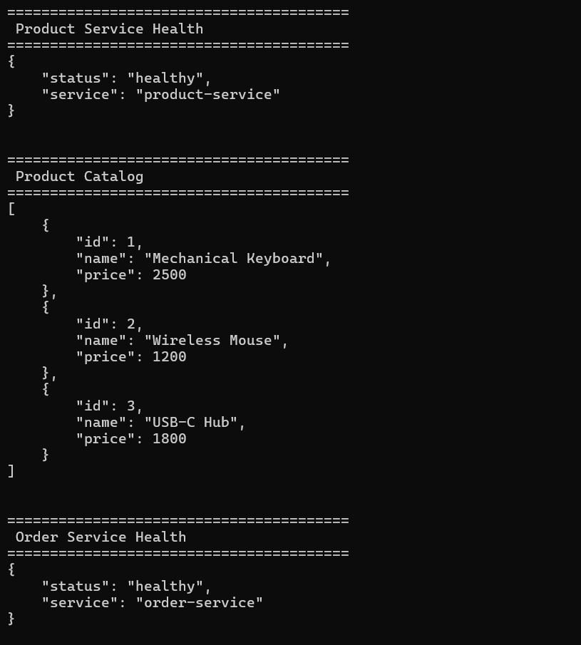
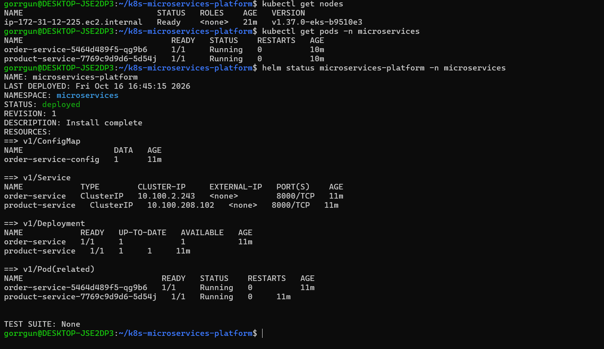
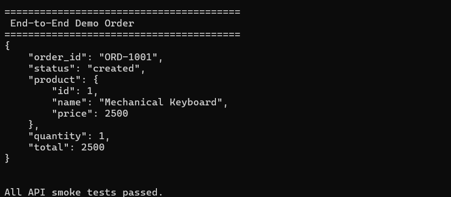

# Kubernetes Microservices Platform

A containerized platform consisting of two Python FastAPI microservices. It supports local development with Docker Compose and `kind`, plus an AWS EKS deployment provisioned with Terraform and released with Helm.

## Architecture

The platform contains two FastAPI microservices:

- **Product Service** — exposes product information through a REST API.
- **Order Service** — retrieves product information from Product Service to create a demonstration order.

The services can run locally using Docker Compose or `kind`, and have also been deployed to an AWS EKS cluster. The EKS workloads are exposed as internal ClusterIP Services; the verified cloud smoke tests used `kubectl port-forward` rather than a public application endpoint.

```text
                  Client
                    |
          +---------+---------+
          |                   |
          v                   v
   Product Service      Order Service
      FastAPI               FastAPI
          ^                   |
          |                   |
          +-------------------+
             HTTP request
          to Product Service

       Local Kubernetes (kind)
       Namespace: microservices
```

In Kubernetes, each application runs in a Deployment and is exposed internally through a ClusterIP Service. Kubernetes DNS allows Order Service to reach Product Service using its Service name.

## Technology Stack

- Python 3.12
- FastAPI and Uvicorn
- HTTPX for inter-service HTTP requests
- Docker and Docker Compose
- Kubernetes and `kubectl`
- `kind` — Kubernetes in Docker
- GitHub Actions
- GitHub Container Registry (GHCR)
- Argo CD (separate GitOps demo)
- Terraform and Amazon EKS
- Helm
- Kubernetes ConfigMaps and Secrets
- Readiness and liveness probes
- Resource requests and limits
- Horizontal Pod Autoscaler (HPA)
- NGINX Ingress
- Metrics Server
- Prometheus and `prometheus-client` application instrumentation
- Grafana dashboards and alert rules

## Project Structure

```text
k8s-microservices-platform/
├── .github/
│   └── workflows/
│       └── ci.yml
├── services/
│   ├── product-service/
│   │   ├── app/
│   │   │   └── main.py
│   │   ├── Dockerfile
│   │   └── requirements.txt
│   └── order-service/
│       ├── app/
│       │   └── main.py
│       ├── Dockerfile
│       └── requirements.txt
├── scripts/
│   └── deploy-local.sh
├── terraform/
│   └── eks/                 # EKS infrastructure as code
├── helm/
│   └── k8s-microservices-platform/  # Helm chart
├── k8s/
│   ├── product-service.yaml
│   ├── order-service.yaml
│   ├── order-service-config.yaml
│   ├── product-service-hpa.yaml
│   ├── product-ingress.yaml
│   ├── volume-demo.yaml
│   └── gitops-demo/
│       ├── drift-demo.yaml
│       └── README.md
├── monitoring/
│   ├── prometheus.yml
│   └── grafana/
│       └── grafana.yaml
├── evidence/
│   └── eks/                 # EKS smoke-test output and screenshots
├── docker-compose.yml
├── .gitignore
└── README.md
```

## Services and API Endpoints

### Product Service

| Method | Endpoint | Description |
|---|---|---|
| GET | `/health` | Health check |
| GET | `/version` | Returns the service version |
| GET | `/products` | Lists available products |
| GET | `/products/{product_id}` | Retrieves a product by ID |
| GET | `/metrics/` | Prometheus metrics endpoint |

Sample product IDs: `1`, `2`, and `3`.

### Order Service

| Method | Endpoint | Description |
|---|---|---|
| GET | `/health` | Health check |
| GET | `/orders/demo` | Creates a demonstration order using Product Service data |
| GET | `/metrics/` | Prometheus metrics endpoint |

The Order Service uses the `PRODUCT_SERVICE_URL` environment variable to locate Product Service. Its HTTP request has a three-second timeout, and dependency failures are returned as HTTP 502 responses.

The demonstration order is not persisted to a database.

## Run Locally with Docker Compose

### Prerequisites

Install Docker and Docker Compose.

Build and start both services:

```bash
docker compose up --build -d
```

Check the running containers:

```bash
docker compose ps
```

Test the APIs:

```bash
curl http://localhost:8001/health
curl http://localhost:8001/products
curl http://localhost:8001/version

curl http://localhost:8002/health
curl http://localhost:8002/orders/demo
```

View service logs:

```bash
docker compose logs -f product-service
docker compose logs -f order-service
```

Stop the services:

```bash
docker compose down
```

Docker Compose configures Order Service to call Product Service using the internal service name `product-service`.

## Run in Kubernetes

The Kubernetes manifests target a local `kind` cluster and use the `microservices` namespace.

### 1. Verify the cluster

```bash
kubectl config current-context
kubectl get nodes
```

The expected context for this environment is `kind-microservices`.

If the cluster does not exist, create it:

```bash
kind create cluster --name microservices
```

### 2. Build the application images

Run these commands from the repository root:

```bash
docker build \
  -t k8s-microservices-platform-product-service:v2 \
  ./services/product-service

docker build \
  -t k8s-microservices-platform-order-service:latest \
  ./services/order-service
```

Load the images into the `kind` cluster:

```bash
kind load docker-image \
  k8s-microservices-platform-product-service:v2 \
  --name microservices

kind load docker-image \
  k8s-microservices-platform-order-service:latest \
  --name microservices
```

The local image tags must match the tags in the Kubernetes Deployment manifests. The CI workflow also publishes service images to GHCR.

### 3. Create the namespace and application configuration

```bash
kubectl create namespace microservices \
  --dry-run=client -o yaml | kubectl apply -f -
```

Apply the ConfigMap:

```bash
kubectl apply -f k8s/order-service-config.yaml
```

Create a local practice Secret for the current manifest:

```bash
kubectl create secret generic app-secret \
  --namespace microservices \
  --from-literal=DB_PASSWORD='local-practice-only' \
  --dry-run=client -o yaml | kubectl apply -f -
```

This value is for local use only. The current application does not use this password, and no real credentials should be committed to Git.

### 4. Deploy the services

```bash
kubectl apply -f k8s/product-service.yaml
kubectl apply -f k8s/order-service.yaml
```

Wait for the Deployments to become ready:

```bash
kubectl rollout status deployment/product-service -n microservices
kubectl rollout status deployment/order-service -n microservices
```

Inspect the resources:

```bash
kubectl get deployments,pods,services -n microservices
kubectl get endpointslices -n microservices
```

### 5. Test the APIs

Use port forwarding to access the services from your machine:

```bash
kubectl port-forward \
  -n microservices service/product-service 8001:8000
```

In a separate terminal:

```bash
curl http://localhost:8001/health
curl http://localhost:8001/products
curl http://localhost:8001/version
```

For Order Service, use another terminal:

```bash
kubectl port-forward \
  -n microservices service/order-service 8002:8000
```

Then test:

```bash
curl http://localhost:8002/health
curl http://localhost:8002/orders/demo
```

Stop port forwarding with `Ctrl+C` when finished.


## AWS EKS Deployment

The project has been deployed to Amazon EKS using Terraform for infrastructure and Helm for application resources.

- **Cluster:** `microservices-demo` (Kubernetes 1.37, `us-east-1`)
- **Worker capacity:** one `t3.small` managed node in the demo configuration
- **Infrastructure:** Terraform EKS module, EKS add-ons, CloudWatch control-plane logs with seven-day retention, and a KMS key alias for the cluster
- **Application release:** Helm release `microservices-platform` in namespace `microservices`
- **Images:** Product Service and Order Service images published to GHCR and pinned to a commit-SHA tag
- **Service access:** ClusterIP Services, tested through `kubectl port-forward`; no public application Ingress or LoadBalancer is configured for this EKS deployment
- **Evidence:** see [`evidence/eks/`](evidence/eks/) for smoke-test output and screenshots

### Deploy the application to an existing EKS cluster

First configure `kubectl` for the intended cluster and ensure the required namespace and Secret exist. Do not commit real credentials or print Secret values.

```bash
aws eks update-kubeconfig --region us-east-1 --name microservices-demo
kubectl get nodes
kubectl create namespace microservices --dry-run=client -o yaml | kubectl apply -f -
```

Create the `app-secret` Secret securely in your environment before deploying. The chart expects the key `DB_PASSWORD`; the current application does not use this value.

Install or update the Helm release from the repository root:

```bash
helm upgrade --install microservices-platform \
  ./helm/k8s-microservices-platform \
  --namespace microservices \
  --set productService.replicaCount=1 \
  --set orderService.replicaCount=1
```

Verify the release and workloads:

```bash
helm status microservices-platform -n microservices
kubectl get deployments,pods,services -n microservices
kubectl rollout status deployment/product-service -n microservices
kubectl rollout status deployment/order-service -n microservices
```

### Smoke-test the EKS services

Run each port-forward command in a separate terminal:

```bash
kubectl port-forward -n microservices service/product-service 8001:8000
```

```bash
curl http://localhost:8001/health
curl http://localhost:8001/products
```

```bash
kubectl port-forward -n microservices service/order-service 8002:8000
```

```bash
curl http://localhost:8002/health
curl http://localhost:8002/orders/demo
```

Expected checks include healthy responses from both services and a demo order containing product details and the calculated total. The captured run is recorded in [`evidence/eks/api-smoke-tests.txt`](evidence/eks/api-smoke-tests.txt).

### Terraform infrastructure

Terraform configuration is located in [`terraform/eks/`](terraform/eks/). Review the variables and current AWS account/region before running Terraform. `terraform plan` should be reviewed before any apply or destroy operation. EKS and its supporting resources can incur charges while provisioned; destroy the demo infrastructure when you are finished using it, after reviewing the destroy plan.

## CI/CD

GitHub Actions is configured in `.github/workflows/ci.yml`.

- Runs automated tests for Product Service and Order Service on pushes and pull requests to `main`.
- Builds and publishes service container images to GitHub Container Registry (GHCR) for non-pull-request builds.
- Publishes commit-SHA and `latest` image tags.

The repository includes `scripts/deploy-local.sh`, which applies the local Kubernetes configuration, waits for rollout completion, and performs health/smoke checks.

## GitOps

Argo CD is used for a separate GitOps example under `k8s/gitops-demo/`. The `gitops-drift-demo` Application tracks that repository path and demonstrates Git-driven replica updates and self-healing. Argo CD is **not currently managing the Product Service or Order Service Deployments**.

## Kubernetes Concepts Implemented

### Deployments and Services

- Declarative Deployment and Service manifests.
- ClusterIP Services for internal application access.
- Service discovery using Kubernetes DNS.
- EndpointSlice inspection to verify backend endpoints.
- Self-healing through Deployment-managed Pods.

### Application Configuration

- ConfigMap-based configuration for `PRODUCT_SERVICE_URL`.
- Secret-based environment variable reference for `DB_PASSWORD`.
- Environment-specific configuration without hardcoding the Product Service URL into the Kubernetes manifest.

### Health Checks and Resources

Both application Deployments define:

- HTTP readiness probes using `/health`.
- HTTP liveness probes using `/health`.
- CPU requests of `50m` and memory requests of `64Mi`.
- CPU limits of `500m` and memory limits of `256Mi`.

These settings provide a foundation for scheduling, application health management, and resource-aware scaling.

### Rolling Updates and Rollbacks

Rolling updates and rollback operations have been practiced using Kubernetes Deployments.

Useful commands:

```bash
kubectl rollout status deployment/product-service -n microservices
kubectl rollout history deployment/product-service -n microservices
kubectl rollout undo deployment/product-service -n microservices
```

### Horizontal Pod Autoscaler

The Product Service HPA is defined in `k8s/product-service-hpa.yaml`.

- Minimum replicas: `2`
- Maximum replicas: `4`
- Target average CPU utilization: `50%`

Apply and inspect it:

```bash
kubectl apply -f k8s/product-service-hpa.yaml

kubectl get hpa -n microservices
kubectl describe hpa product-service -n microservices
kubectl top pods -n microservices
```

HPA requires working resource metrics from Metrics Server. The HPA configuration and metrics have been verified in the local environment; successful scale-up under sustained load has not yet been demonstrated.

### Ingress

The Ingress manifest routes requests for `product.local` to Product Service.

File: `k8s/product-ingress.yaml`

This requires a compatible Ingress controller, appropriate local hostname resolution, and cluster access configuration. The manifest alone does not install an Ingress controller.

### Volumes

The `k8s/volume-demo.yaml` manifest demonstrates an `emptyDir` volume mounted at `/data`.

An `emptyDir` volume is temporary storage associated with the lifetime of its Pod. It is useful for shared container storage and ephemeral data, but it is not persistent storage for production workloads.

## Phase 5: Monitoring and Observability

Prometheus and Grafana run in the local Kubernetes cluster in the `monitoring` namespace.

### Prometheus

Configuration is in `monitoring/prometheus.yml`. Prometheus scrapes itself and both application services:

- Product Service: `product-service.microservices.svc.cluster.local:8000/metrics/`
- Order Service: `order-service.microservices.svc.cluster.local:8000/metrics/`

The application scrape paths use `/metrics/` because the mounted metrics application redirects the path without the trailing slash.

Useful checks:

```bash
kubectl get pods -n monitoring
kubectl get configmap prometheus-config -n monitoring
kubectl port-forward -n monitoring svc/prometheus 9090:9090
```

Open `http://localhost:9090/targets` and verify that the Prometheus, Product Service, and Order Service targets are `UP`.

Example PromQL queries:

```promql
up
```

```promql
sum by (service) (rate(http_requests_total[5m]))
```

```promql
100 * sum by (service) (rate(http_requests_total{status=~"5.."}[5m]))
/ clamp_min(sum by (service) (rate(http_requests_total[5m])), 0.001)
```

```promql
histogram_quantile(
  0.95,
  sum by (le, service) (rate(http_request_duration_seconds_bucket[5m]))
)
```

These queries show scrape status, request rate by service, estimated HTTP 5xx percentage, and p95 request latency by service.

### Grafana

Grafana is deployed using `monitoring/grafana/grafana.yaml` and uses Prometheus as its data source. A request-rate panel has been created, and alert rules have been configured for:

1. Product or Order Service scrape target down.
2. High HTTP 5xx percentage.
3. High p95 request latency.
4. Any Prometheus scrape target down.

Alert evaluation depends on the configured query, threshold, and pending period. Generate requests and use controlled test failures where safe to exercise the queries before relying on them operationally.

**Reproducibility note:** The Grafana Deployment and Service are version-controlled, but dashboards and alert rules created manually in the Grafana UI are not yet fully provisioned from Git. Export or provision them before treating a fresh deployment as fully reproducible.


## EKS Deployment Evidence

The following screenshots were captured from the successful EKS deployment and smoke tests.

| Evidence | Screenshot |
|---|---|
| EKS workloads and services |  |
| Helm release status |  |
| API smoke tests |  |

## Troubleshooting Commands

Inspect Pods and events:

```bash
kubectl get pods -n microservices -o wide
kubectl describe pod <pod-name> -n microservices
kubectl get events -n microservices --sort-by=.metadata.creationTimestamp
```

Inspect logs:

```bash
kubectl logs deployment/product-service -n microservices
kubectl logs deployment/order-service -n microservices
```

Check resource usage:

```bash
kubectl top nodes
kubectl top pods -n microservices
```

Check rollout status:

```bash
kubectl rollout status deployment/product-service -n microservices
kubectl rollout status deployment/order-service -n microservices
```

Common issues include image-tag mismatches, missing ConfigMaps or Secrets, failed health probes, unavailable dependency endpoints, and missing resource metrics.

## Security Notes

- `k8s/app-secret.yaml` is intentionally excluded by `.gitignore`.
- Do not commit real passwords, tokens, cloud credentials, or private keys.
- Kubernetes Secrets are not automatically secure merely because their values are base64-encoded. Production deployments need appropriate access controls and secret-management practices.
- The Metrics Server TLS workaround used in this local environment is not a production configuration.
- The current manifests and local cluster are not a production-hardened deployment.

## Next Steps

1. **Centralized Logging:** collect and search logs across the services and Kubernetes workloads, then practice log-based troubleshooting.
2. **Reproducibility:** provision Grafana dashboards and alert rules from version-controlled configuration.
3. **Reliability testing:** run controlled failure simulations, validate alert behavior, and document recovery steps.
4. **Optional cloud enhancements:** configure and test EKS ingress and HPA scaling only when needed, with cost and cleanup plans.

## Roadmap

| Phase | Scope | Status |
|---|---|---|
| 1 | Dockerized FastAPI microservices and Docker Compose | Completed |
| 2 | Kubernetes fundamentals, service discovery, configuration, probes, rollouts, Ingress and volumes | Completed |
| 3 | Resource management, Metrics Server, HPA and reliability concepts | Covered; further load testing planned |
| 4 | CI/CD with GitHub Actions, automated tests, image publishing and Argo CD GitOps example | Completed |
| 5 | Monitoring and observability with Prometheus, application metrics, Grafana dashboards and alert rules | Implemented locally|
| 6 | Terraform infrastructure and AWS EKS deployment with Helm | Completed; smoke tests passed |
| 7 | Centralized logging and log-based troubleshooting | Next |
| 8 | Failure simulations, incident troubleshooting and interview preparation | Planned |

